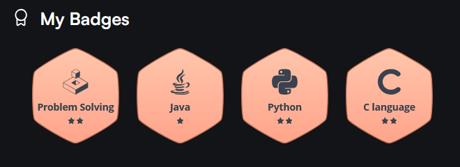
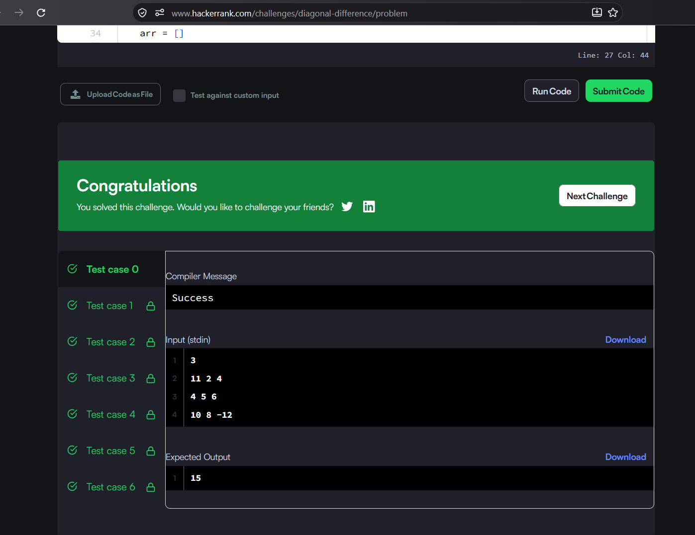
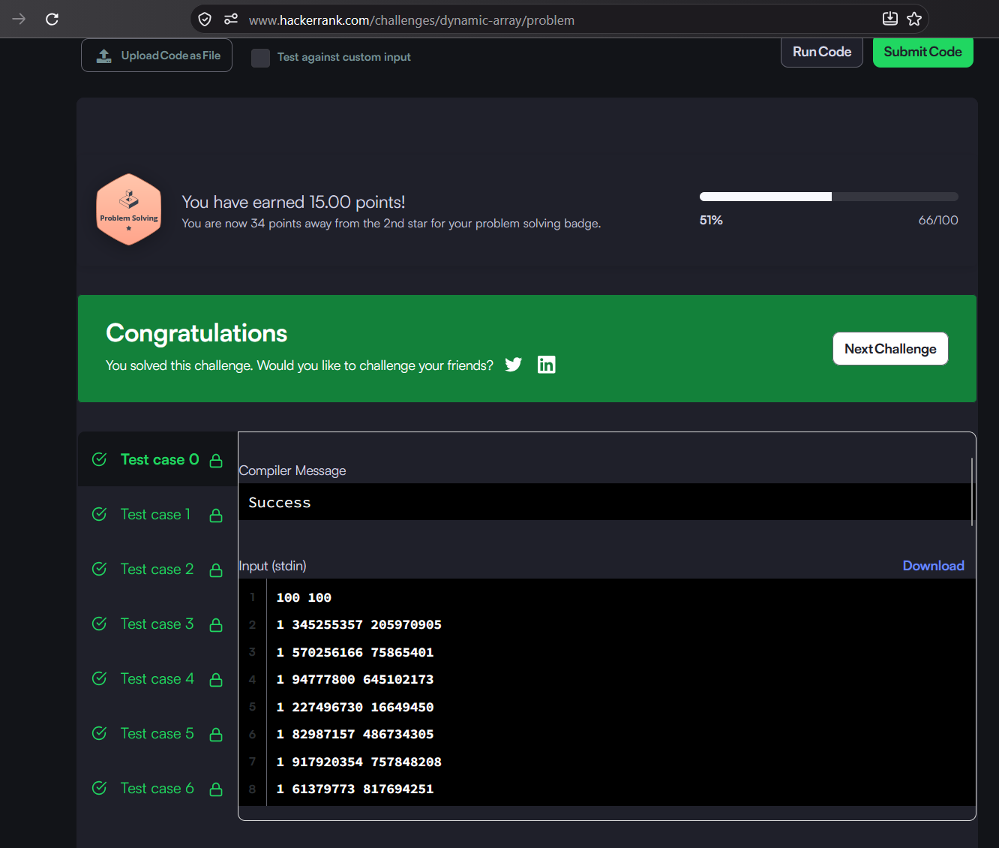
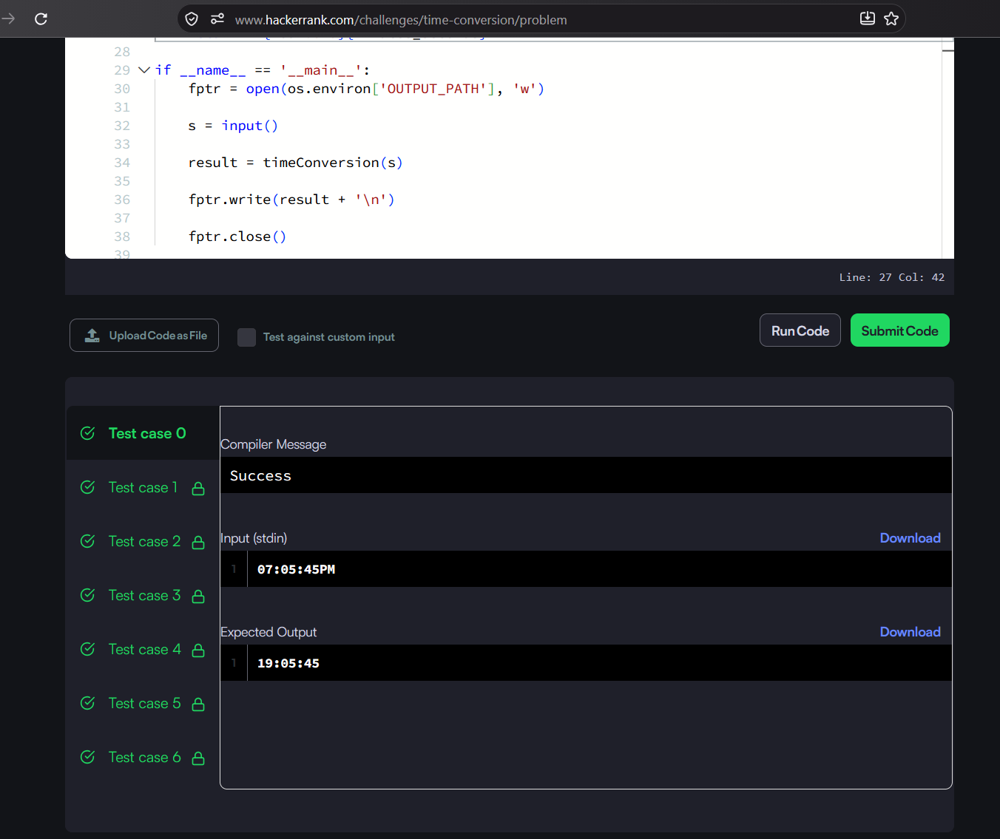
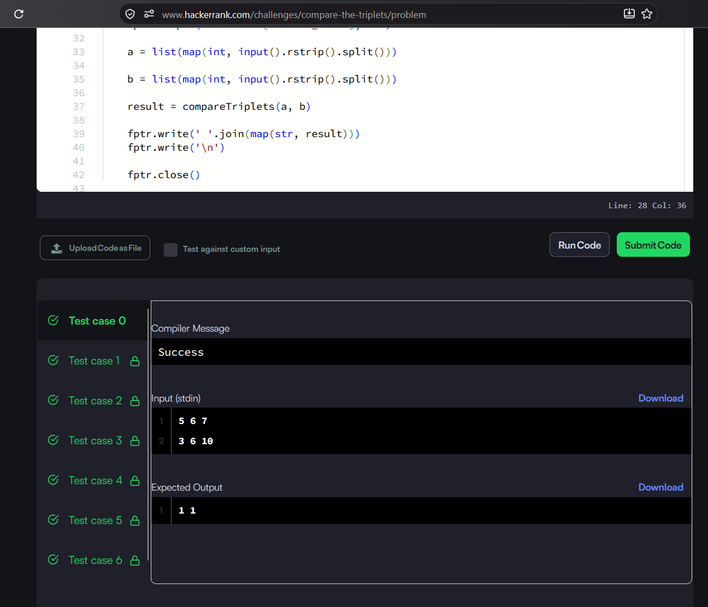
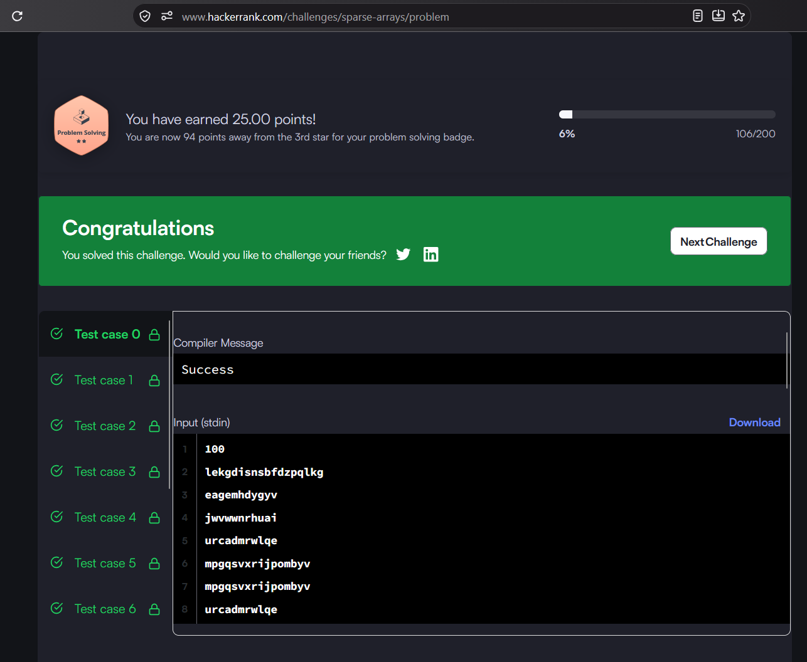

# HackerRank 3rd Semester Portfolio (HackerRank-3rdSem-Portfolio)

- **Student Name:** Rishab Vernekar
- **SRN:** R25EF217
- **Course:** B25CS0311 / B25GE0101 — Portfolio Building (3rd Semester CSE, REVA University)
- **HackerRank Profile:** [https://www.hackerrank.com/profile/rishabvernekar31](https://www.hackerrank.com/profile/rishabvernekar31)

## Overview
This repository documents clean, optimal Python 3 solutions for the five mandatory algorithmic problems in Activity 8, demonstrating 2D matrix traversal, dynamic sequence manipulation with bitwise XOR, string formatting, array comparison, and hash-map frequency lookup.

## Time & Space Complexity Summary

| # | Problem Name | Topic / Category | Solution | Time Complexity | Space Complexity |
| :--- | :--- | :--- | :--- | :--- | :--- |
| 1 | Diagonal Difference | 2D Arrays / Matrices | [solution.py](./Diagonal-Difference/solution.py) | O(N) | O(1) |
| 2 | Dynamic Array | Data Structures / Vectors | [solution.py](./Dynamic-Array/solution.py) | O(N + Q) | O(N) |
| 3 | Time Conversion | Strings & Logic | [solution.py](./Time-Conversion/solution.py) | O(1) | O(1) |
| 4 | Compare the Triplets | Basic Implementation | [solution.py](./Compare-the-Triplets/solution.py) | O(1) | O(1) |
| 5 | Sparse Arrays | Hash Maps / Strings | [solution.py](./Sparse-Arrays/solution.py) | O(N + Q) | O(N) |

## Skill Badges

## Accepted Submissions
### 1. Diagonal Difference

### 2. Dynamic Array

### 3. Time Conversion

### 4. Compare the Triplets

### 5. Sparse Arrays

